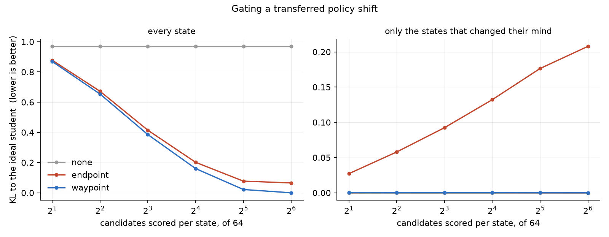

<h1 align="center">waypoint-opd</h1>

<p align="center">
  <a href="https://github.com/tatra-labs/waypoint-opd/actions/workflows/tests.yml"></a>
  <a href="https://arxiv.org/abs/2610.21601"></a>
  <a href="LICENSE"></a>
</p>

<p align="center"><b>An RL run that changed its mind still leaves a shift behind. Don't copy it.</b><br>
One extra checkpoint from the middle of the run tells you which transferred preferences to trust.</p>

When you distil an RL-post-trained teacher into a student, what is worth transferring is not the
teacher's distribution — the models are different sizes — but how post-training *moved* the
teacher's preferences. Take the log-prob difference between the final and the initial checkpoint,
centre it over the student's own candidates, and you have that movement.

[*Waypoint-OPD*](https://arxiv.org/abs/2610.21601) (October 2026) points out what that endpoint
difference cannot see. A run that pushed hard one way for ten thousand steps and then pushed back
for the next ten thousand leaves a residue at the endpoint that looks exactly like a preference,
and is not one. Keep one checkpoint from the middle, split the run into halves, and the cosine
between the two halves' shifts tells them apart:

```
early = centre(logp_W − logp_I)        late = centre(logp_F − logp_W)
gate  = max(0, cos(early, late))       signal = gate · centre(logp_F − logp_I)
```

Reinforcing halves gate to 1 and transfer in full; opposing halves gate to 0 and transfer nothing.
The cost is one more frozen-teacher scoring pass.

**waypoint-opd** is a small implementation of that gate and the loss around it, plus the two
experiments it takes to say whether the idea is any good: a synthetic post-training run where it is
known which shifts were real, and a measurement of how often a *real* released post-training run
disagrees with itself.

```bash
pip install -e ".[dev,experiments]"
python experiments/synthetic.py          # about 20 seconds, CPU
pytest -q
```

## Does the gate find the shifts that changed their mind?

On real checkpoints nobody knows which of a teacher's endpoint shifts were durable, so
`experiments/synthetic.py` builds a run where it is known. Every state gets one of two histories:

* **steady** — both halves push the same way; the endpoint shift is real, and a student should take
  all of it;
* **wandering** — the first half pushes hard, the second half pushes back less hard. A sizeable
  endpoint shift survives in a direction that meant nothing, and a student should take none of it.

Then distil into a *different* student three ways and measure KL to the student it should have
become: its own initial policy plus the real shifts and nothing else.

| transfer | KL to ideal | on steady states | on wandering states |
|---|---:|---:|---:|
| none | 0.9695 | 1.4095 | 0.0000 |
| endpoint-only | 0.4145 | 0.5598 | 0.0924 |
| **gated (waypoint)** | **0.3856** | 0.5598 | **0.0002** |

<sub>512 states, 64-way vocabulary, 8 candidates scored per state, 30% wandering, 3 seeds. Lower is
better. `python experiments/synthetic.py --k 8 --steps 1500 --seeds 3`</sub>

The gate separates the two histories perfectly — **mean gate 1.000 on steady states and 0.000 on
wandering ones** — and the error endpoint-only transfer picks up on wandering states drops by 450×.
On steady states the two are identical to four decimals, as they must be: when the halves agree the
gate is 1 and the methods are the same function.

But the overall column only moves 7%, and the reason is worth knowing.

## What the gate is worth depends on how many candidates you score

Both methods share a floor: a shift centred over the student's top-8 candidates can only reorder
those eight, and the ideal shift involves all 64 logits. That floor is identical for both and it
dominates the average. Widen the candidate set and it disappears, leaving only the part the gate is
about:

| candidates scored | endpoint-only | gated | gated is |
|---:|---:|---:|---|
| 2 | 0.8777 | 0.8693 | 1.0% better |
| 4 | 0.6721 | 0.6540 | 2.7% better |
| 8 | 0.4145 | 0.3856 | 7.0% better |
| 16 | 0.2018 | 0.1603 | 20.6% better |
| 32 | 0.0771 | 0.0216 | 71.9% better |
| 64 (all) | 0.0654 | **0.0000** | 100% better |

<sub>`python experiments/synthetic.py --sweep k --steps 1500 --seeds 3` → `figures/synthetic_k.png`</sub>

At full coverage the gated student reaches the ideal exactly, and **every bit of error endpoint-only
transfer has left is the residue it absorbed from the wandering states**. The narrower the candidate
set, the more of the gate's benefit is hidden behind a floor that has nothing to do with gating. If
you are reproducing this kind of result, `k` is not a detail.



## When does gating cost you?

The gate is a bet: *if the halves disagree, the residue is noise.* Two sweeps say what the bet is
worth and when it loses.

**How often the run changed its mind** — the more wandering states, the more there is to gate, and
the gate never costs anything when there are none:

| wandering states | none | endpoint-only | gated |
|---:|---:|---:|---:|
| 0% | 1.4005 | 0.5494 | 0.5494 |
| 20% | 1.1158 | 0.4606 | 0.4410 |
| 40% | 0.8468 | 0.3704 | 0.3345 |
| 60% | 0.5609 | 0.2716 | 0.2159 |
| 80% | 0.2739 | 0.1775 | 0.1030 |
| 100% | 0.0000 | 0.0925 | **0.0002** |

At the bottom row every endpoint shift is residue, and endpoint-only transfer is *worse than not
distilling at all* — it moves a student away from where it should be. The gate reduces that to
nothing.

**How often a change of mind really was noise** — and here is the honest half. Hold the wandering
share at 30% and vary how often those residues were actually worth having:

| residues that really were noise | endpoint-only | gated |
|---:|---:|---:|
| 0% | 0.4169 | 0.4485 ✗ |
| 20% | 0.4165 | 0.4337 ✗ |
| 40% | 0.4171 | 0.4219 ✗ |
| 60% | 0.4163 | 0.4103 ✓ |
| 80% | 0.4152 | 0.3969 ✓ |
| 100% | 0.4145 | 0.3856 ✓ |

<sub>`python experiments/synthetic.py --sweep honest` → `figures/synthetic_honest.png`</sub>

The crossover sits at 50%, where it should: the gate throws away a shift whenever the halves
disagree, so it wins exactly when disagreement means noise more often than not. Below that it is
discarding real supervision. Which makes the premise an empirical question, not a design choice.

## Does a real post-training run disagree with itself?

Gating is only worth a scoring pass if real runs actually reverse themselves on the prefixes a
student visits. Checking that needs a released run with its *intermediate* checkpoint, which is
rare — but OLMo 2 published the whole pipeline:

```
allenai/OLMo-2-0425-1B-SFT  →  -DPO  →  -Instruct
        Initial                Waypoint     Final
```

`experiments/checkpoints.py` has `allenai/OLMo-2-0425-1B` (the base model, which never saw any of
that post-training) generate completions, records its own top-k candidates at every generated
position, scores all three checkpoints on exactly those candidates, and reports the gate statistics.
Nothing is trained. Teachers are loaded one at a time and freed, so it runs in 8 GB.

```bash
python experiments/checkpoints.py --device cuda --max-new-tokens 64
```

<!--CHECKPOINT_RESULTS-->

## Using it

The library is two files and depends only on torch.

```python
from waypoint_opd import gather_logps, opd_loss, topk_candidates

ids, student_at_ids = topk_candidates(student_logits, k=8)       # on-policy candidates
loss, parts = opd_loss(
    student_at_ids,
    gather_logps(initial_logits, ids),        # the frozen teacher before RL
    gather_logps(waypoint_logits, ids),       # ... partway through
    gather_logps(final_logits, ids),          # ... after
    logp_reference=gather_logps(reference_logits, ids),   # the student, frozen, before distillation
    beta=1.0,
)
parts["gate"]       # per position: 1 where the halves agreed, 0 where they fought
parts["cos"]        # the agreement itself
parts["shift"]      # what endpoint-only transfer would have used
```

`opd_loss(..., gated=False)` is the endpoint-only baseline and needs no waypoint, so the two arms
are the same code path with one argument changed. The target is

```
target = softmax(log π_reference + β · signal)        loss = KL(target ‖ π_student)
```

with the target detached. Anchoring on a frozen *reference* student rather than the running one is
what gives the objective a fixed point; anchor on the running student (omit `logp_reference`) and
the loss pushes forever, which only makes sense under a fixed step budget.

## What is a reading, and what is measured

The paper describes the gate — three checkpoints, centred relative-preference segment vectors,
cosine agreement, `max(0, c)`, a low-norm fallback — and reports distillation results on Qwen3
teachers and students. It does not publish the loss, the fallback rule, or code. So:

* **the gate is the paper's**, implemented as described;
* **the loss around it is a reading of it**, written down explicitly above. A KL to a
  reference-anchored, shift-reweighted target is the natural way to transfer a *relative* change,
  but it is not stated to be theirs;
* **the low-norm fallback is a choice.** When a half changed nothing, the cosine is noise. The
  default `fallback=1.0` behaves like endpoint-only transfer there — conservative. `fallback=0.0`
  transfers only what the waypoint positively vouches for;
* **the experiments here are not the paper's.** Its numbers are reasoning benchmarks after real RL
  distillation runs on 8B–30B students. Nothing in this repository reproduces those, and the
  tables above are not comparable to them.

Still open, and the reason that last point stands: **an actual distillation run**, student trained
both ways on the OLMo chain, scored on a downstream task. That needs more compute than a laptop and
is the obvious next thing to add.

## Tests

`pytest -q` — 18 tests, no GPU, a few seconds. They pin the parts that are easy to get subtly
wrong: that centring makes a teacher's overall change in confidence invisible, that the endpoint
shift is exactly the two halves added, that opposing halves gate to zero *while still carrying a
large endpoint shift*, that a right angle gates to zero too, that a flat half falls back instead of
dividing by noise, and that gated and endpoint transfer are the same function when the halves agree.

## Licence

MIT. Paper: [arXiv:2610.21601](https://arxiv.org/abs/2610.21601). Checkpoints:
[OLMo 2](https://huggingface.co/collections/allenai/olmo-2-674117b93ab84e98afc72edc), Apache 2.0.
